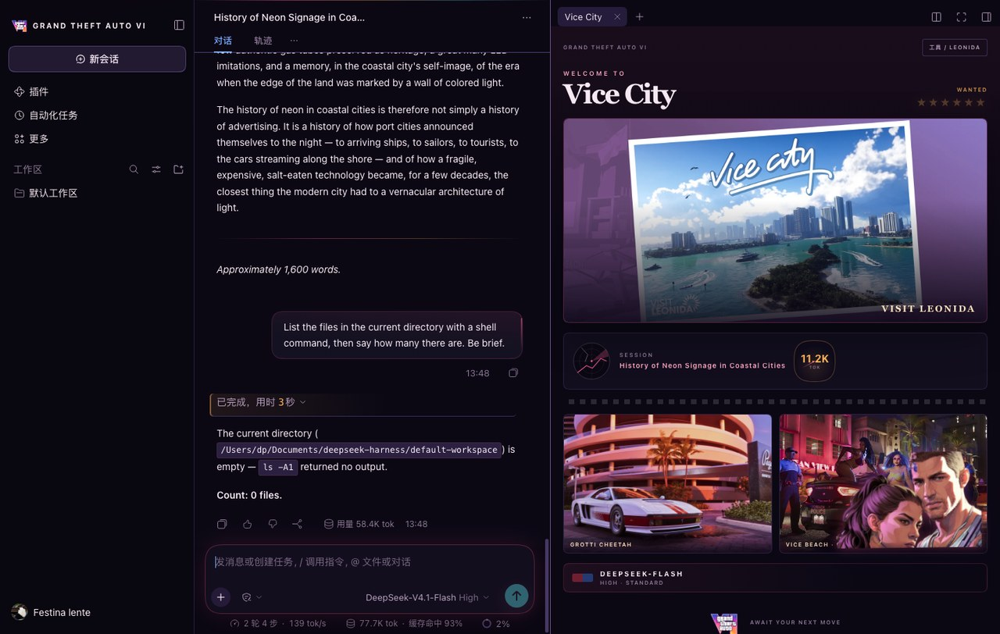
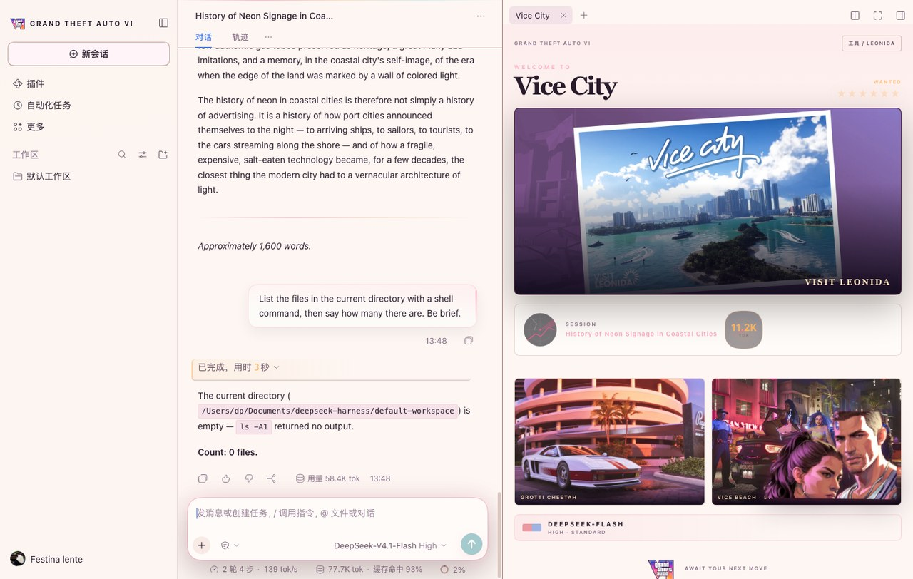
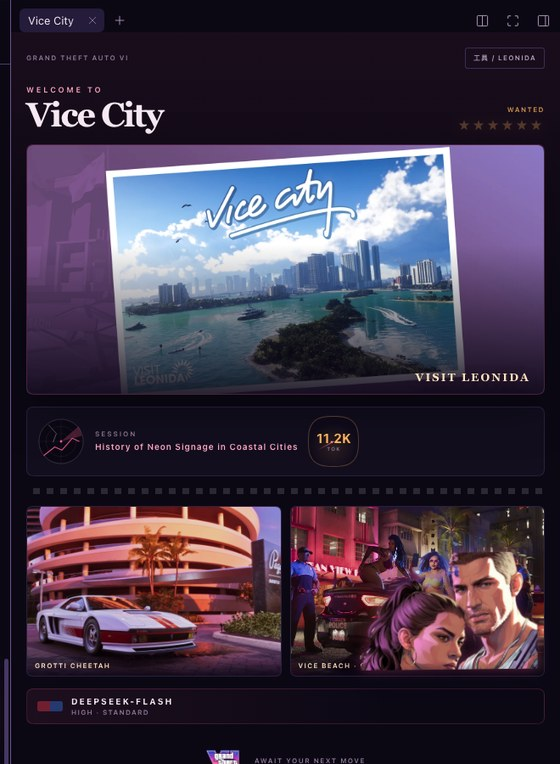

# dsh-gta6

**Move DeepSeek Harness to the Leonida coastline.**

A GTA VI theme: a wanted-level meter driven by the agent's own run state, a sidebar that is a real session dashboard, and two characters in the corner who get tired.

[](https://www.npmjs.com/package/dsh-gta6)
[](LICENSE)
[](https://github.com/deepseek-ai/deepseek-harness)

[中文](README.md)



<sub>Light mode is complete too:</sub>



---

## Wanted level

In GTA, six stars mean the police are after you. Here they are wired to what the agent is doing — start a task and the six stars light up one by one; finish it and they clear at once.

The signal comes from the host's own session state, not from scraping the page for a "stop generating" button. It does not break when you change language or window size.

You do not need a progress bar. One glance tells you whether it is working or has been idle for a while.



## The sidebar is a real dashboard

The "Vice City" tab subscribes to the host's session service and shows the current session's title, cumulative token usage, model and reasoning level. Switch sessions and it follows.

It is not a painted-on graphic.

## Tool-call rows are coloured by action

Thinking, reading files, searching, editing code, running commands, planning — one colour each. When a long task scrolls past, the colour rhythm down the screen is the trail of what it just did.

The colouring hangs off the host's semantic markers rather than its hashed class names, so a host release is less likely to break all of it at once.

## Desktop pets

Jason and Lucia, cut from the official key art. The longer a task runs, the wearier they look; they get drowsy at night; click one and it says a line.

Drag them anywhere, or switch them off in settings.

---

## Install

```bash
dsh plugin --profile <profile> add dsh-gta6
```

From GitHub:

```bash
dsh plugin --profile <profile> add github:manyuemeiquqi/dsh-gta6
```

**From the in-app market**: add this address under `Settings → Plugins → Custom plugin index`, then open **Discover**:

```
https://raw.githubusercontent.com/manyuemeiquqi/dsh-gta6/master/market/index.json
```

### Installed an older version?

The pnpm bundled with the host only picks npm versions **published more than 24 hours ago**, as supply-chain protection. So for the first day after a release, `dsh plugin add dsh-gta6` resolves to the previous version.

Pin the version to get the new one:

```bash
dsh plugin --profile <profile> add 'dsh-gta6@^0.1.1'
```

That writes the package into the profile's `pnpm-workspace.yaml` under `minimumReleaseAgeExclude`. After 24 hours, the plain command picks up the new version too.

### After installing

The profile's `package.json` should list the bundle:

```json
{
  "dependencies": { "dsh-gta6": "^0.1.0" },
  "dsh": {
    "profile": {
      "bundles": ["@deepseek-ai/dsh-base", "@deepseek-ai/dsh-web-app", "dsh-gta6"]
    }
  }
}
```

> After changing code, run `npm run build` and reload the plugin. Refreshing the page alone will not evict the cached module.

---

## Settings

`Settings → Plugins → GTA VI · Vice City`:

| Key | Default | Purpose |
| --- | --- | --- |
| `enabled` | `1` | Master switch: palette and all interface decoration |
| `background` | `1` | Key-art banner, sidebar artwork, empty-state scene |
| `opacity` | `72` | Background opacity (0–100) |
| `blur` | `0` | Background blur (0–24px) |
| `glow` | `1` | Neon glow on headings, borders and buttons |
| `motion` | `1` | Message entrance animation and tool-row sweep |
| `intro` | `1` | Intro animation |
| `pet` | `1` | Desktop pets |

Everything respects `prefers-reduced-motion`.

---

## Compatibility

- DeepSeek Harness `>= 0.2.0 < 0.3.0`
- Node.js `>= 24.9.0` (build time only)

The host is still in preview and its plugin API may keep moving. Styles hang off the host's `data-*` semantic markers (`data-process-activity`, `data-message-bubble` and so on) rather than hashed class names, but a release may still require follow-up.

---

## Artwork and licensing

Interface artwork comes from Rockstar Games' published GTA VI promotional material. **Copyright Rockstar and Take-Two.** It is not covered by this project's MIT licence; per-asset sourcing and the original parts are listed in [NOTICE.md](NOTICE.md).

This plugin is not affiliated with Rockstar Games, Take-Two Interactive or DeepSeek, and is not endorsed by them.

## Development

```bash
npm install
npm run build   # produces index.js and client.js
npm run check   # build + syntax check
```

`index.js` and `client.js` are build artefacts committed to the repo. Do not edit them by hand.

```text
src/
  host/index.cjs            # host entry and config schema
  shared/constants.js       # plugin id, asset paths, defaults
  client/
    index.js                # client entry: assembly and lifecycle only
    core/
      run-signal.js         # run state: one observer, many subscribers
      session-state.js      # session data: title / tokens / model
      art.js                # original SVG: palms, skyline, radar, stars
    features/
      theme/ conversation/ tools/ wanted/ panel/ pet/ brand/ scene/ intro/ motion/
market/index.json           # in-app market index (format 1)
docs/shots/                 # README screenshots
```

**Conventions**

- Every CSS rule is namespaced with `vice-` or scoped to `body[data-vice-*]`.
- Selectors use `data-*` semantic markers, never hashed class names.
- To add padding without moving layout, use `padding` with an equal negative `margin`.
- Every feature's teardown must release its listeners, observers and injected styles.
- State is read from the host's services; page text is never scraped.

See [LICENSE](LICENSE).
