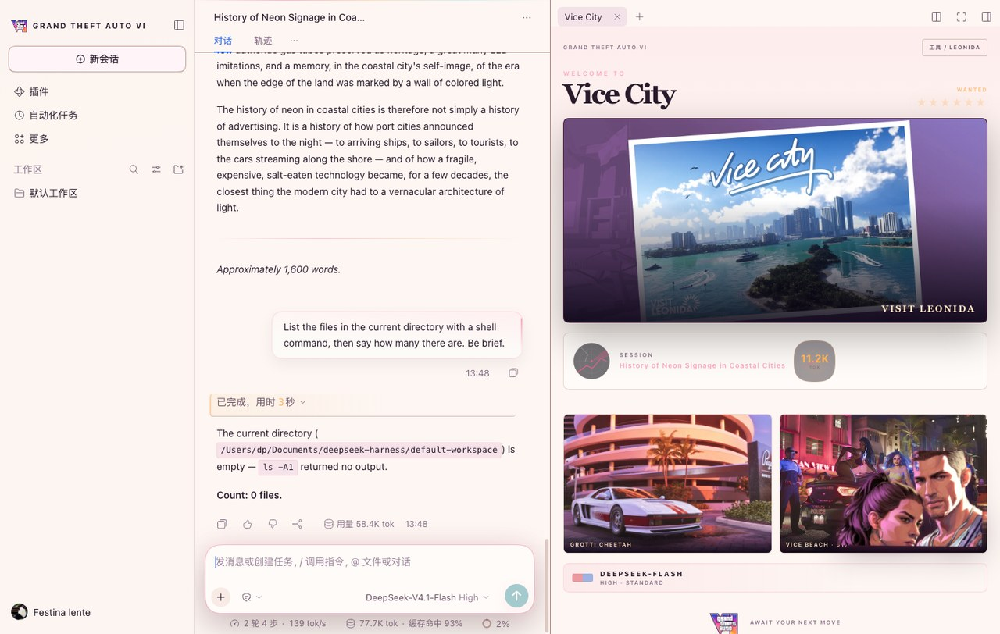

# dsh-gta6

**把 DeepSeek Harness 换到雷奥奈达的海岸线上。**

一套 GTA VI 主题：通缉星级接 Agent 的运行状态，右栏是真实的会话仪表盘，角落住着两个会累的人物。

[](https://www.npmjs.com/package/dsh-gta6)
[](LICENSE)
[](https://github.com/deepseek-ai/deepseek-harness)

[English](README.en.md)


<sub>浅色配色同样完整：</sub>



---

## 通缉星级

GTA 里六颗星的意思是警察在追你。这里它接的是 Agent 的运行状态——任务开始，右下角六颗星依次点亮；任务结束，瞬间归零。

判断依据是宿主会话服务里的运行字段，不是去扫页面上有没有「停止生成」按钮。所以它不会因为你换了语言、换了窗口尺寸就失灵。

不用挂进度条，扫一眼就知道它是在干活还是已经闲置半天。


## 右栏是真仪表盘

「Vice City」标签页订阅宿主的会话服务，显示当前会话的标题、累计消耗的 token、调用的模型和推理档位。切会话，它跟着换。

不是画上去的贴图。

## 工具调用行按动作分色

思考、读文件、搜索、改代码、执行命令、出方案，一类一个颜色。长任务一路滚下来的时候，整屏的颜色节奏就是它这一路的轨迹。

着色挂的是宿主的语义标记，不是那些带哈希的类名——宿主发版之后，样式不容易整体失效。

## 桌面宠物

Jason 与 Lucia，从官方主视觉里抠出来的。跑得越久越没精神，夜里会犯困，点一下说一句话。

可以拖到屏幕任意位置，也能在设置里关掉。

---

## 安装

```bash
dsh plugin --profile <profile> add dsh-gta6
```

从 GitHub 装：

```bash
dsh plugin --profile <profile> add github:manyuemeiquqi/dsh-gta6
```

**从应用内市场安装**：`设置 → 插件 → 自定义插件索引` 添加下面这个地址，然后切到「发现」：

```
https://raw.githubusercontent.com/manyuemeiquqi/dsh-gta6/master/market/index.json
```

### 装出来是旧版本？

宿主内置的 pnpm 默认只选**发布满 24 小时**的 npm 版本，用来防供应链投毒。所以新版本刚发出来的头一天，`dsh plugin add dsh-gta6` 会装到上一版。

想要新版就显式写版本号：

```bash
dsh plugin --profile <profile> add 'dsh-gta6@^0.1.1'
```

这条命令会把它写进 profile 的 `pnpm-workspace.yaml` 的 `minimumReleaseAgeExclude`，之后正常升级即可。等 24 小时过去，不带版本号也会装到新版。

### 装完确认

profile 的 `package.json` 里应已列入 bundles：

```json
{
  "dependencies": { "dsh-gta6": "^0.1.2" },
  "dsh": {
    "profile": {
      "bundles": ["@deepseek-ai/dsh-base", "@deepseek-ai/dsh-web-app", "dsh-gta6"]
    }
  }
}
```

> 改过代码后要重新 `npm run build` 并重载插件；只刷新页面不会清掉已缓存的模块。

---

## 配置

`设置 → 插件 → GTA VI · Vice City`：

| 键 | 默认 | 说明 |
| --- | --- | --- |
| `enabled` | `1` | 总开关：配色与全部界面装饰 |
| `background` | `1` | 主视觉横幅、右栏画报与空状态场景 |
| `opacity` | `72` | 背景不透明度（0–100） |
| `blur` | `0` | 背景模糊（0–24px） |
| `glow` | `1` | 标题、边框与按钮的霓虹光晕 |
| `motion` | `1` | 消息进场动画与工具行扫光 |
| `intro` | `1` | 开场动画 |
| `pet` | `1` | 桌面宠物 |

全部动效遵循 `prefers-reduced-motion`：系统开启「减少动态效果」时自动静止。

---

## 兼容性

- DeepSeek Harness `>= 0.2.0 < 0.3.0`
- Node.js `>= 24.9.0`（仅构建期需要）

宿主仍在预览阶段，插件 API 可能继续变化。样式优先挂宿主的 `data-*` 语义标记（`data-process-activity`、`data-message-bubble` 等），不绑哈希类名，但发版后仍可能需要跟进。

---

## 素材与授权

界面美术来自 Rockstar Games 官方发布的 GTA VI 宣传物料，**著作权归 Rockstar 与 Take-Two**，不在本项目 MIT 许可范围内。逐项来源、原创部分与授权说明见 [NOTICE.md](NOTICE.md)。

本插件与 Rockstar Games、Take-Two Interactive、DeepSeek 均无隶属关系，未获其背书。

## 开发

```bash
npm install
npm run build   # 生成 index.js、client.js
npm run check   # build + 语法检查
```

`index.js` 与 `client.js` 是构建产物，随仓库提交，不要手改。目录结构、代码约定和各 feature 的职责见 [CONTRIBUTING.md](CONTRIBUTING.md)。

许可证见 [LICENSE](LICENSE)。
