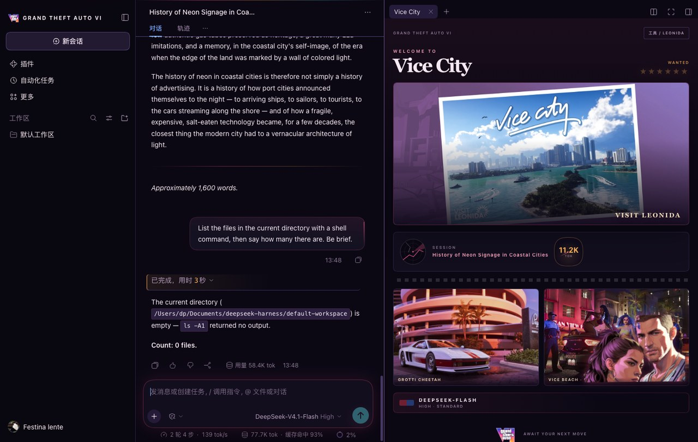
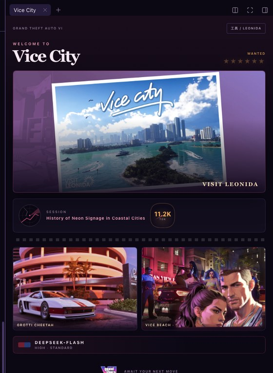
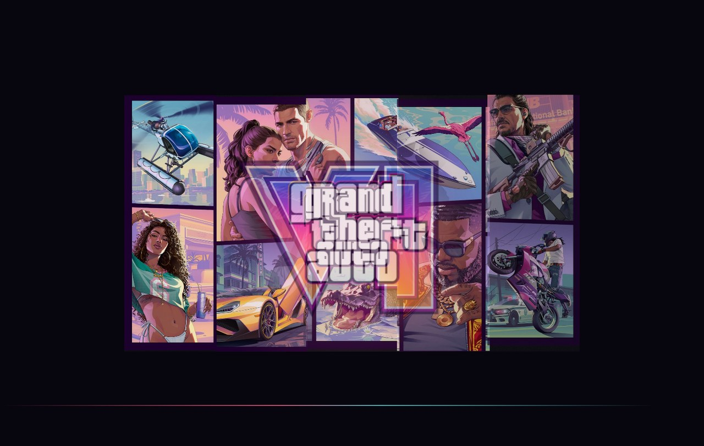

# dsh-gta6

**给 DeepSeek Harness 的 Vice City 主题。** 用 Rockstar 官方 GTA VI 主视觉重做了界面里几个最常被看到的位置，
外加一只会跟着 Agent 状态变化的桌面宠物。

[](https://www.npmjs.com/package/dsh-gta6)
[](LICENSE)
[](https://github.com/deepseek-ai/deepseek-harness)



<sub>浅色配色同样完整：</sub>


---

## 它做了什么

不是换一套配色那种主题。它改的是几个「每次用都会看到」的位置：

| | |
|---|---|
| **通缉星级** | 六颗星跟着 Agent 真实的运行状态亮起，不是装饰 |
| **右栏仪表盘** | 会话标题、累计 token、模型与推理档位，全部来自宿主真实数据 |
| **工具调用行** | 按动作着色：思考紫、读取青、搜索蓝、编辑绿、命令琥珀、规划玫红 |
| **桌面宠物** | Jason 与 Lucia，可拖动、会犯困、会跟着任务变疲惫 |
| **主视觉横幅** | 会话顶部换成官方主视觉，替代默认标题 |
| **开场动画** | 五块碎片拼合、标识放大、扫描线掠过 |

### 通缉星级跟随真实状态

GTA 最有辨识度的语言，恰好能对上 Agent 的状态：街道安静，直到它开始干活。
星级读的是宿主自己的会话状态，不扫页面文字——开始生成即亮起，结束归零。



### 右栏是真仪表盘

「Vice City」标签页订阅宿主的会话服务，显示当前会话的标题、累计 token、模型与推理档位。
切会话，它跟着变。

### 桌面宠物

Jason 与 Lucia，从官方主视觉插画抠出。会跟着任务变累、夜里会困、点一下会说话，可拖到任意角落。

### 开场动画



五块碎片拼合，约 3 秒。

---

## 安装

```bash
dsh plugin --profile <profile> add dsh-gta6
```

从 GitHub 装：

```bash
dsh plugin --profile <profile> add github:manyuemeiquqi/dsh-gta6
```

**从应用内市场安装**：`设置 → 插件 → 自定义插件索引` 添加下面这个地址，然后切到「发现」：

```
https://raw.githubusercontent.com/manyuemeiquqi/dsh-gta6/master/market/index.json
```

装好后确认 profile 的 `package.json` 里已列入 bundles：

```json
{
  "dependencies": { "dsh-gta6": "^0.1.0" },
  "dsh": {
    "profile": {
      "bundles": ["@deepseek-ai/dsh-base", "@deepseek-ai/dsh-web-app", "dsh-gta6"]
    }
  }
}
```

> 改过代码后要重新 `npm run build` 并重载插件；只刷新页面不会清掉已缓存的模块。

---

## 配置

`设置 → 插件 → GTA VI · Vice City`：

| 键 | 默认 | 说明 |
| --- | --- | --- |
| `enabled` | `1` | 总开关：配色与全部界面装饰 |
| `background` | `1` | 主视觉横幅、右栏画报与空状态场景 |
| `opacity` | `72` | 背景不透明度（0–100） |
| `blur` | `0` | 背景模糊（0–24px） |
| `glow` | `1` | 标题、边框与按钮的霓虹光晕 |
| `motion` | `1` | 消息进场动画与工具行扫光 |
| `intro` | `1` | 开场动画 |
| `pet` | `1` | 桌面宠物 |

全部动效遵循 `prefers-reduced-motion`：系统开启「减少动态效果」时自动静止。

---

## 兼容性

- DeepSeek Harness `>= 0.2.0 < 0.3.0`
- Node.js `>= 24.9.0`（仅构建期需要）

宿主仍在预览阶段，插件 API 可能继续变化。选择器优先挂宿主的 `data-*` 语义标记
（`data-process-activity`、`data-message-bubble` 等），不绑哈希类名，但发版后仍可能需要跟进。

---

## 素材与授权

界面美术来自 Rockstar Games 官方发布的 GTA VI 宣传物料，**著作权归 Rockstar 与 Take-Two**，
不在本项目 MIT 许可范围内。逐项来源、原创部分与授权说明见 [NOTICE.md](NOTICE.md)。

本插件与 Rockstar Games、Take-Two Interactive、DeepSeek 均无隶属关系，未获其背书。

## 开发

```bash
npm install
npm run build   # 生成 index.js、client.js
npm run check   # build + 语法检查
```

`index.js` 与 `client.js` 是构建产物，随仓库提交，不要手改。

```text
src/
  host/index.cjs            # 宿主入口与配置 schema
  shared/constants.js       # 插件 id、素材路径、默认值
  client/
    index.js                # 客户端入口，只负责组装与生命周期
    core/
      run-signal.js         # 运行状态：一个 observer，多订阅者
      session-state.js      # 会话数据：标题 / token / 模型
      art.js                # 原创 SVG：棕榈、天际线、雷达、星点
    features/
      theme/ conversation/ tools/ wanted/ panel/ pet/ brand/ scene/ intro/ motion/
market/index.json           # 应用内市场索引（format 1）
docs/shots/                 # README 截图
```

**约定**

- CSS 一律带 `vice-` 命名空间或 `body[data-vice-*]` 作用域，不污染全局元素。
- 选择器挂 `data-*` 语义标记，不绑哈希类名。
- 需要加内边距又要保持布局时，用 `padding` + 等量负 `margin` 抵消。
- 每个 feature 的清理函数必须完整释放监听器、Observer 与注入的样式。
- 不扫描页面文字推断状态；只读宿主自己的服务与控件。

许可证见 [LICENSE](LICENSE)。
