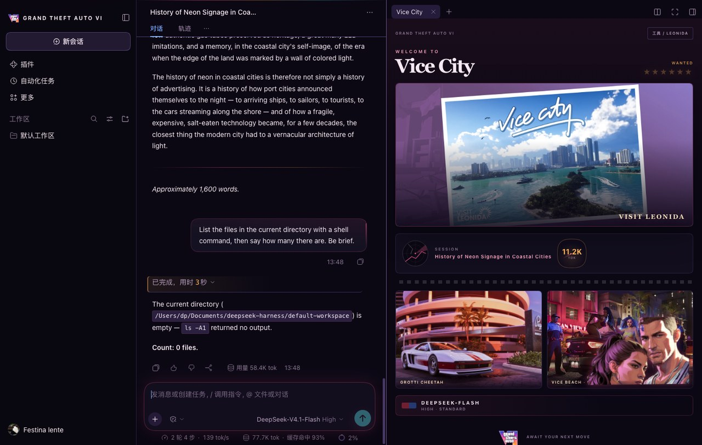
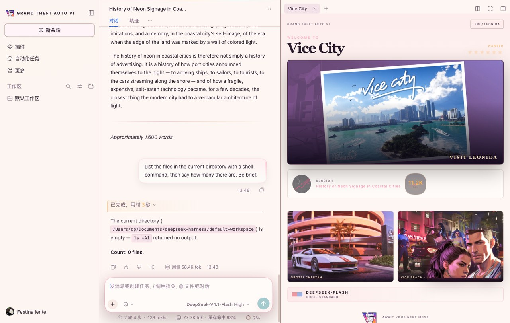

# 给别人的客户端写主题插件，怎么在它发版之后还活得下去

我给 DeepSeek Harness（一个开源 AI Agent 客户端）做了个 GTA VI 主题插件：霓虹配色、随 Agent 运行状态亮起的通缉星级、右栏会话仪表盘。插件叫 dsh-gta6，MIT 协议，npm 可装。

这篇不讲主题本身，讲一个更普遍的问题：**你给别人的客户端写插件，宿主每周都在发新版，你的插件怎么不被每次发版带走？**

宿主的迭代速度你控制不了。接口会变，DOM 结构会变，依赖的位置会变。如果你的插件搭在宿主的实现细节上，那宿主每次发版都是一次轮盘赌。几轮迭代下来，我沉淀出几条规则，核心是一句话：**把依赖面缩到最小，让每一处依赖都可恢复、可降级、可退出。**

## 一、走正门，别撬窗

主题插件最诱人的写法是直接覆盖宿主样式：审查元素，找到类名，写一个优先级更高的选择器压上去。见效快，坏得也快——宿主改个类名、调一层 DOM，你的样式就落空，更糟的是落到别人身上。

正确姿势是用宿主官方的主题接口。DSH 提供 token 级覆盖：你交出自己的设计令牌（色板、圆角、间距），宿主自己负责应用，并返回一个恢复函数：

```js
function install() {
  if (!restore) restore = ctx.theme.overrideTokens(PLUGIN_ID, palette)
}
function uninstall() {
  restore?.()
  restore = undefined
}
```

两个细节：

- 覆盖以插件 ID 登记。宿主知道这是谁的样式，不跟别的插件打架；
- 恢复函数拿在手里。用户关掉主题，调一下就还原，不用刷新页面。

自己额外加的样式，同样要命名空间化。我的 CSS 变量全部以 `--vice-` 开头，dataset 键全部以 `vice` 开头，style 标签带 `data-plugin` 标记。卸载时只删自己的东西，宿主的字节一个不碰：

```js
export function installStyles(pluginId, chunks) {
  const sheet = document.createElement('style')
  sheet.dataset.plugin = pluginId
  sheet.textContent = chunks.filter(Boolean).join('\n')
  document.head.appendChild(sheet)
  return () => sheet.remove()
}
```

**检验标准很简单：插件卸载之后，宿主是不是和装之前一模一样？** 是，说明边界干净；不是，说明你在哪儿留了东西。

## 二、读信号，别刮文本

主题里有个仪表盘，显示当前会话的 token 消耗和所用模型。直觉写法是从页面上刮渲染出来的文本：找到显示 token 数的元素，读 innerText，解析数字。

别这么干。渲染文本是宿主的「表现层」，它会被格式化、被截断、被翻译、被 A/B 测试。今天显示 `12.3k`，明天显示 `12,345`，你的解析器当场去世。

宿主内部有真正的数据源：会话列表 store，带快照和订阅机制。读快照、订阅变更：

```js
ctx.inject(['sessions'], child => {
  const list = child.sessions.list
  snapshot = list.getSnapshot()
  const unsubscribe = list.subscribe(() => {
    snapshot = list.getSnapshot()
    emit()
  })
  ctx.effect(() => () => unsubscribe())
})
```

结构化字段是契约，渲染文本不是。

但有一件事 store 不告诉你：**当前屏幕上的是哪个会话**。这里我用了一个、也是唯一一个 DOM 锚点——宿主在会话区域上发布的稳定 data 属性。只盯这一个元素、这一个属性：

```js
observer.observe(watched, {
  attributes: true,
  attributeFilter: ['data-conversation-session'],
})
```

React 会把元素整个换掉，所以监听要懒重挂：每次读取前检查元素还在不在，被换掉了就重新 attach。依赖一个稳定属性，好过依赖一串选择器。

## 三、不可靠的信号，给降级链，再给防抖

通缉星级要知道「Agent 现在是不是在跑」。首选来源是会话 store 里的 running 标志，那是事实。但根页面上、或者会话列表还没加载时，store 给不出答案。

于是准备降级：页面上的「停止生成」按钮。它在，就说明在跑。按 aria-label 匹配，中英文都放进集合：

```js
const STOP_LABELS = new Set(['停止生成', 'Stop generating'])

function read() {
  const session = sessionState?.current?.()
  if (session && typeof session.running === 'boolean') return session.running
  return readStopControl()
}
```

降级来源是提示，不是事实，所以还要配两件事：

- **防抖**。流式回复时页面一秒钟突变几百次，MutationObserver 的回调只负责排程，安静 260ms 之后才真正读取。
- **一个来源，多个订阅者**。星级和桌面宠物都要这个状态，共享一个 observer、一个防抖扫描，别让每个功能各盯各的 DOM。

降级链也会坏——宿主哪天改了按钮文案，它就失效。但坏只坏在一个函数里，换一组标签就能修好。这就是把脆弱依赖隔离出来的好处：**坏的时候坏在一处，修的时候也修在一处。**

## 四、假设依赖会缺席

插件的宿主侧入口需要一个 schema 库来声明配置。某些宿主版本里，这个库不在插件的 require 路径上。直接 require 会抛错，整个插件加载失败。

我的写法是三层降级：

```js
function loadSchema() {
  try {
    const loaded = require('@deepseek-ai/schemastery')
    return loaded.default || loaded
  } catch {
    try {
      if (typeof require.main?.require !== 'function') return undefined
      const loaded = require.main.require('@deepseek-ai/schemastery')
      return loaded.default || loaded
    } catch {
      return undefined
    }
  }
}
```

拿不到就返回 undefined，下游用可选链（`z?.object(...)`）接住：配置声明缺席，但插件照样加载。**少一个配置面板，好过让宿主报错。** 宿主侧的 apply 是个空函数，真正的活全在客户端侧——宿主侧入口越薄，能被坏东西波及的面就越小。

## 五、声明版本区间，给自己留余地

package.json 里：

```json
"engines": { "dsh": ">=0.2.0 <0.3.0" }
```

这行做两件事：告诉宿主和用户，你验证过哪些版本；也告诉自己，minor 版本应当兼容，major 不承诺。

但声明不是护身符，真正让你活下来的是宿主每次发版后的跟进流程：

1. 装上新宿主，把插件完整跑一遍：安装、启用、每个开关拨一次、卸载；
2. 重点看你依赖的那几个接口：主题 token 变没变、store 字段变没变、data 属性变没变；
3. 坏了就当天修、当天发。插件的口碑建立在「宿主更新了，它还能用」上。

我没法预测宿主什么时候改什么，但我能决定它改的时候我疼在哪：依赖面已经收敛到少数几个文件，改动只会发生在那几个文件里。

## 六、能干净地离开

每个模块都有 dispose：退订、断开 observer、删 style 标签、清 dataset 键、清空监听器。检验标准同第一条：卸载之后宿主和原来一模一样，不用刷新。

这不只是礼貌。用户会频繁开关主题，如果每次开关都泄漏一点——多一个 observer、多一张 style 标签——页面会越来越慢。用户会怪宿主，宿主会怪你。

## 写在最后

回头看，这些规则其实是同一件事：**分清契约和实现。** 公开接口、结构化字段、稳定属性、语义化标签，这些是契约；类名、DOM 层级、渲染文本、依赖位置，这些是实现。依赖契约，隔离实现，给每一处实现依赖留好降级和退出。

宿主会继续发版。你拦不住它，但你可以让它每次发版，都只花你很小的代价。

---

主题长这样（深色 / 浅色）：





会话主视觉横幅、Vice City 霓虹配色、随 Agent 状态亮起的通缉星级、右栏实时仪表盘，还有两个会随任务变累的桌面宠物。安装：`npm i dsh-gta6`；仓库：[manyuemeiquqi/dsh-gta6](https://github.com/manyuemeiquqi/dsh-gta6)（MIT）。

素材取自 Rockstar 官方公布的 GTA VI 宣传物料，著作权归 Rockstar 与 Take-Two，不在项目 MIT 许可范围内，仓库另附来源说明。项目与 Rockstar、DeepSeek 均无隶属关系。