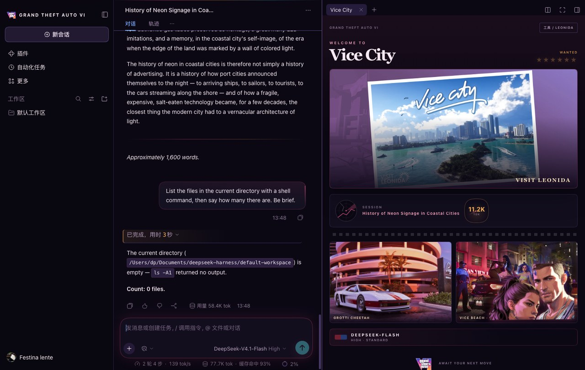

# 推广文案

给不同渠道准备的现成文本。原则：具体 > 形容词；先给能看见的那一个点（通缉星级跟着跑），再补充其余。

---

## 一句话

> DeepSeek Harness 的 Vice City 主题：Agent 一开工，通缉星级就亮起来。

---

## GitHub Discussions 展示帖

**标题**

```
【插件】dsh-gta6：让 Agent 开工时亮起通缉星级，再养两只 Jason 和 Lucia
```

**正文**

```markdown
做了一个 GTA VI 主题，但不是换套配色那种。

真正想做的一件事：GTA 的通缉星级恰好能对上 Agent 的状态——街道是安静的，
直到它开始干活。所以六颗星读的是宿主自己的会话状态（`sessions` 服务里的
`running`），开始生成就亮到 6 星，结束瞬间归零。不扫页面文字，也不猜。

顺带做了这些：

- **右栏「Vice City」标签页**：不是贴图。订阅宿主会话数据，显示当前会话标题、
  累计 token、模型与推理档位，切换会话跟着变。
- **工具调用行按动作着色**：思考紫、读取青、搜索蓝、编辑绿、命令琥珀、规划玫红。
  挂在宿主的 `data-process-activity` 上，不绑哈希类名。
- **桌面宠物**：Jason 与 Lucia，从官方主视觉插画抠出来的。会跟着任务变累、
  夜里会困、点一下会说话、可以拖到任意角落。
- **开场动画**：五块碎片拼合。



安装：

```bash
dsh plugin --profile <profile> add dsh-gta6
```

仓库：https://github.com/manyuemeiquqi/dsh-gta6

素材来自 Rockstar 官方宣传物料，著作权归 Rockstar 与 Take-Two，不在 MIT 范围内，
详见 NOTICE.md。插件与 Rockstar、DeepSeek 均无隶属关系。

宿主还在预览期，插件 API 可能会变。有反馈欢迎直接在这里说。
```

---

## 微博 / X

```
给 DeepSeek Harness 做了个 GTA VI 主题。

最喜欢的一个设计：通缉星级接的是 Agent 的真实状态——它一开始生成，
六颗星就亮起来；跑完瞬间归零。

右栏那块也不是贴图，是当前会话的标题、token 和模型。
还养了 Jason 和 Lucia 在角落。

npm i dsh-gta6 / github.com/manyuemeiquqi/dsh-gta6
```

---

## 即刻 / 朋友圈 / 群消息

```
给 DeepSeek Harness 写了个 GTA VI 主题插件。

不是换个配色：Agent 一开始干活，角落的通缉星级就亮到 6 星，干完归零；
右边那块面板显示的是真实会话数据；右下角还蹲着 Jason 和 Lucia。

一行装：dsh plugin --profile <名字> add dsh-gta6
```

---

## 一条更短的（配图用）

```
Agent 开工，通缉星级亮起。
—— 给 DeepSeek Harness 的 GTA VI 主题，dsh-gta6
```

---

## 发之前提醒自己

1. **配图优先用 `docs/shots/overview-dark.jpg`**，一张就能说明问题（星级、面板、宠物同框）。
2. **不要用"最好用的 DSH 主题"这类说法**——没依据，而且容易招反感。
3. 素材是 Rockstar 的官方美术，公开推广等于把这件事放到明面上。发之前确认授权说法你站得住。
4. DSH 讨论区是社区实际在用的曝光渠道，比任何"市场收录"都有效。
5. 有人反馈兼容性问题时，先问宿主版本——API 还在变，很可能是版本差。
