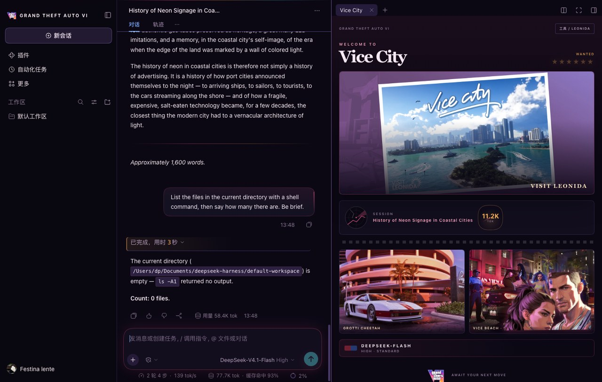
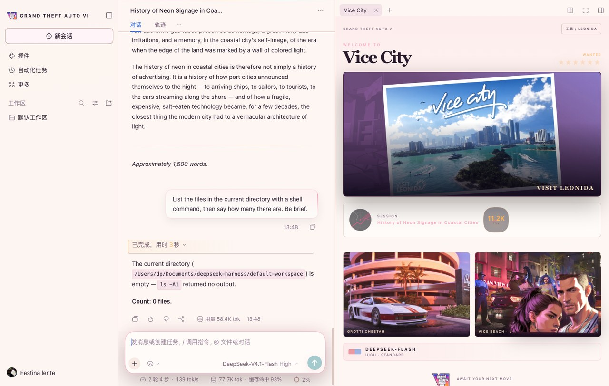
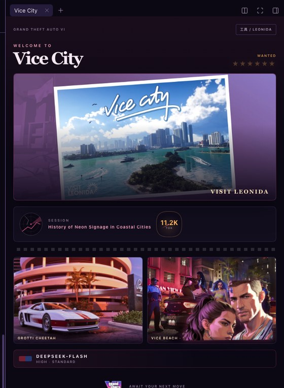

# 给 DeepSeek Harness 换上 GTA 6 皮肤：Agent 一干活，通缉星级就亮

自荐一个我做的开源项目：**dsh-gta6**，给 DeepSeek Harness（开源 AI Agent 客户端）做的 GTA VI 主题插件。MIT 协议，npm 可装。

- 仓库：https://github.com/manyuemeiquqi/dsh-gta6
- 安装：应用内「设置 → 插件 → 添加插件」输入 `dsh-gta6`，或命令行 `dsh plugin add dsh-gta6`



浅色配色同样完整：



**把 DeepSeek Harness 换到雷奥奈达的海岸线上。** 换的不只是配色：会话顶部是官方主视觉横幅，全局取自 Vice City 的霓虹，明暗两套各自完整。

## 通缉星级

GTA 里六颗星的意思是警察在追你。这里它接的是 Agent 的运行状态——任务开始，右下角六颗星依次点亮；任务结束，瞬间归零。不用挂进度条，扫一眼就知道它是在干活还是已经闲置半天。



## 右栏是真仪表盘

显示当前会话的标题、累计消耗的 token、调用的模型和推理档位。切会话，它跟着换。不是画上去的贴图。

## 工具调用行按动作分色

思考、读文件、搜索、改代码、执行命令、出方案，一类一个颜色。长任务一路滚下来的时候，整屏的颜色节奏就是它这一路的轨迹。

## 桌面宠物

Jason 与 Lucia，从官方主视觉里抠出来的。跑得越久越没精神，夜里会犯困，点一下说一句话。可以拖到屏幕任意位置，也能在设置里关掉。

## 安装与配置

应用内最简单：「设置 → 插件 → 添加插件」，输入 `dsh-gta6`，点安装。

命令行：

```bash
dsh plugin --profile <profile> add dsh-gta6
```

设置里每个装饰都能单独开关：主视觉、光晕、动效、开场动画、宠物，背景不透明度和模糊度可调。全部动效遵循系统的「减少动态效果」设置。适配 DeepSeek Harness 0.2.x。

## 素材与授权

界面美术来自 Rockstar Games 官方发布的 GTA VI 宣传物料，著作权归 Rockstar 与 Take-Two，不在项目 MIT 许可范围内，仓库附逐项来源说明。项目与 Rockstar、Take-Two、DeepSeek 均无隶属关系。

---

欢迎试用，问题和建议直接提 [GitHub issue](https://github.com/manyuemeiquqi/dsh-gta6/issues)。